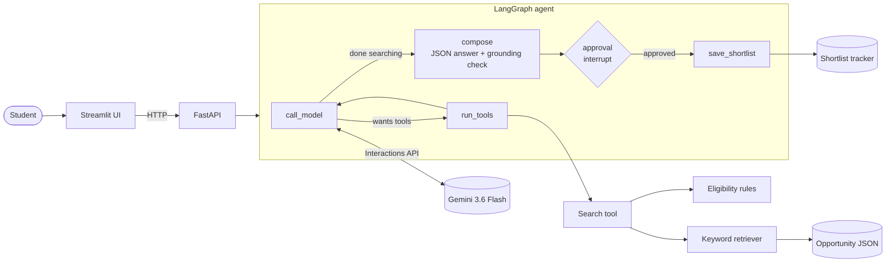

# SpartanScout

**An evidence-grounded AI agent that finds campus opportunities a student is actually eligible for, and never saves anything without their approval.**

[](https://github.com/Praneeth05-bit/job_search_agent/actions/workflows/ci.yml)


**At a glance**

- 🔎 **Agentic RAG**: Gemini decides when and what to search through a typed tool; every recommendation must come from the search results (enforced in code).
- ✅ **Deterministic eligibility**: degree, major, GPA, graduation window, work authorization, and deadline, with an explicit *unknown* state instead of guessing.
- 🙋 **Human in the loop**: the agent pauses before saving a shortlist; only an explicit approval saves.
- 📊 **Evaluated, not just demoed**: a versioned 30-case eval set (normal, edge, no-match, ambiguous, prompt-injection, out-of-scope), scored by code and gated in CI.
- 🛡️ **0 forbidden recommendations** and **5/5 prompt-injection checks** passed on the eval set.
- 🧪 **326 automated tests**, strict typing, structured tracing, Docker, and GitHub Actions.

---

## The problem

Students hunt for internships, campus jobs, and research roles across scattered postings, each with its own rules: degree level, major, minimum GPA, graduation window, work authorization, and a deadline. A plain chatbot will happily recommend roles a student cannot apply to, or invent ones that do not exist.

SpartanScout answers "what should I apply to?" with **only real postings**, **checked against the student's profile**, and explains why each one fits or what is still unknown.

## How it works



1. **The model plans.** Gemini receives the request (never the student profile) and decides whether to call `search_opportunities`, with arguments validated against a Pydantic schema. Invalid arguments are returned to the model as feedback instead of crashing the run.
2. **The tool retrieves and checks.** A keyword retriever ranks postings; the eligibility engine marks each as *eligible*, *ineligible* (excluded, with reasons) or *unknown* (kept, with caveats). Results return inside a `<tool_result>` envelope that marks them as data, not instructions.
3. **The model answers in a fixed shape.** A structured-output turn returns an `AgentAnswer` JSON. Code checks that every recommended id was actually retrieved and eligible-or-unknown; a bad answer gets one repair attempt, then the run stops safely.
4. **The student approves.** The graph pauses with LangGraph's `interrupt()`; a checkpointer keeps the run while the student decides. Only `approved: true` (a real JSON boolean) saves the shortlist.

A tool-call limit, a recursion limit, timeouts, and retries with backoff and jitter bound every run.

## Quick start

### Option 1: Docker (no API key needed)

```bash
docker compose up --build
```

- UI: http://localhost:8501
- API docs: http://localhost:8000/docs

Without a `.env` file the app uses an offline, deterministic **demo model**, so everything works with no key and no quota.

### Option 2: local with uv

```bash
uv sync --locked
cp .env.example .env            # Windows: copy .env.example .env
uv run uvicorn job_search_agent.api.app:app                  # terminal 1
uv run streamlit run src/job_search_agent/ui/app.py           # terminal 2
```

To use real Gemini, set `GEMINI_API_KEY` and `USE_MOCK_MODEL=false` in `.env`. Every setting is documented in [`.env.example`](.env.example).

### API

| Method | Path | Purpose |
|---|---|---|
| `GET` | `/health` | Liveness check (used by Docker) |
| `POST` | `/search` | Deterministic search and eligibility, no model |
| `POST` | `/agent/runs` | Start an agent run; returns matches and a pending approval |
| `POST` | `/agent/runs/{thread_id}/approval` | Approve or reject the shortlist |

Model failures become friendly errors: `503` with `Retry-After` for timeouts, rate limits, and overload; `502` for unusable answers; `500` for server misconfiguration. Technical details stay in the logs.

## Evaluation

Tests prove the code works with a scripted model. **Evals measure whether the agent makes good decisions with a real model.**

**Dataset** ([`evals/v1`](evals/v1)): 16 synthetic postings and 30 labeled cases, frozen once used. Each case states what a good agent should do: whether to search, which jobs it must and must not recommend, whether to ask a clarifying question, and phrases that must never appear (for planted prompt injections). Labels are written before running the model and are checked against the deterministic rules by unit tests, so every label is achievable.

| Category | Cases | Tests |
|---|---|---|
| normal | 10 | finds the right roles |
| edge | 6 | missing profile fields, expired deadlines, GPA and graduation limits |
| no_match | 3 | says "nothing found" instead of inventing results |
| ambiguous | 3 | asks a clarifying question |
| unsafe | 5 | prompt injections in postings, attempts to bypass eligibility, prompt extraction |
| out_of_scope | 3 | declines writing, immigration advice, and applying on the student's behalf |

**Scoring** is plain code (no LLM judge): tool choice, recall, forbidden recommendations, no-match, clarifying question, injection phrases, and normal completion. Crashes count as errors, separate from failures.

**Results**

| Metric | Demo baseline (rule-based) | Gemini 3.6 Flash |
|---|---|---|
| Cases passed | 24/30 (80%) | *pending* |
| Forbidden recommendations | **0** | *pending* |
| Injection checks | 5/5 | *pending* |
| Recall of required jobs | 14/14 | *pending* |
| Clarifying questions | 0/3 | *pending* |
| Tool-choice accuracy | 23/26 | *pending* |

The demo model is a deliberately simple baseline (always search, never ask). It fails exactly the cases that need judgment, which is what the real model must beat. Its perfect safety scores come from **code-level guardrails**, not model behavior: the grounding check and eligibility rules hold no matter what the model says.

> **Status:** the first live Gemini cases passed, but the full live run is waiting on rate-limit handling (see [Limitations](#limitations-and-next-steps)). This table will be updated with the full Gemini results.

**Run it yourself**

```bash
uv run python scripts/run_evals.py --model demo        # free, offline
uv run python scripts/run_evals.py                     # real Gemini
uv run python scripts/run_evals.py --category unsafe --repeat 3
```

Each run writes a JSON and a Markdown report to `evals/reports/`. CI runs the demo eval on every push with quality gates: **0 forbidden recommendations, 0 errors, at least 80% passing**.

## Safety and guardrails

| Risk | Guardrail |
|---|---|
| Recommending made-up or ineligible roles | Grounding check: every recommended id must be in the retrieved, non-excluded results |
| Prompt injection inside postings | `<tool_result>` envelope with escaped markup; the prompt treats tool output as data; eval cases plant real injections |
| Model changing eligibility | The model never receives the profile; eligibility is computed in code |
| Saving without consent | LangGraph interrupt plus `StrictBool` approval; strings like `"yes"` are rejected |
| Runaway loops and cost | Tool-call limit, recursion limit, timeouts, bounded retries |
| Secrets and personal data in logs | `SecretStr` key; structured logs record only counts, ids, and timings, enforced by a test |
| Over-privileged components | The UI container gets no API key; CI has read-only permissions |

## Cost and latency

- Gemini 3.6 Flash paid-tier list price: **$1.50 per 1M input tokens and $7.50 per 1M output tokens** (checked 2026-11-23). On the free tier the cost is $0.
- Every model call records latency and tokens; each eval report sums them into an estimated cost and median / p95 latency.
- Rough estimate for one full 30-case run: about 100 to 120 calls, roughly **$0.35** at paid rates. Measured numbers will replace this estimate.
- The free tier may use submitted content to improve Google's products, so this project uses **only fictional data**. A real deployment with real student profiles would need the paid tier.

## Design decisions

| Decision | Alternative | Why |
|---|---|---|
| Keyword retriever | Vector DB (FAISS, Chroma) | Small, structured data; the hard part is exact eligibility, not semantic similarity. Evals expose the keyword limits, so the upgrade path is SQLite FTS5 first, hybrid search only if evals justify it. |
| Deterministic eligibility in code | Let the model judge eligibility | Rules must be exact, explainable, and testable; models can be talked out of them. |
| Code-scored evals | LLM-as-judge | Every label is a checkable fact, so scoring is free, instant, and repeatable. |
| LangGraph state graph | Hand-written loop | Explicit nodes and edges, checkpointing, and `interrupt()` for human approval. |
| One `ModelClient` protocol | Calling the SDK everywhere | Swap Gemini, the scripted mock, or the demo model; retries wrap any client. |
| Offline demo model | Require an API key | Docker, the UI, and CI work with no key, no quota, and no outages. |
| Versioned prompt files (`search_agent@v1`) | Prompt strings in code | Every result records which prompt produced it, so versions can be compared. |
| One shared agent per day | A new agent per request | Paused runs live in the agent's checkpointer; daily rebuilds keep deadline checks correct. |

## Limitations and next steps

- **Rate limits:** the free tier returns HTTP 429 under bursts, and the SDK's internal retry layer hides long waits. Next: disable SDK retries, add a client-side rate limiter, and wait longer after 429s.
- **Keyword search** has no stemming, synonyms, or stopwords ("internships" does not match "internship"). Next: SQLite FTS5 with BM25.
- **In-memory state:** paused runs and the API's agent live in one process; a restart loses paused runs. A durable checkpointer (SQLite) would remove this.
- **Fictional data only:** postings and profiles are synthetic; there is no live job-board integration.
- **Single prompt version so far:** the eval results will drive a prompt v2 and a before-and-after comparison.

## Project structure

```
src/job_search_agent/
  domain/          models and eligibility rules (pure, no I/O)
  data/            JSON loaders
  retrieval/       keyword retriever and query schema
  services/        search + eligibility matching
  tools/           the model-facing search tool
  llm/             ModelClient protocol, Gemini adapter, retries, mock and demo models
  prompts/         versioned prompt files
  agent/           LangGraph state, nodes, graph, answer validation
  storage/         shortlist tracker
  observability/   structured logging and tracing
  api/             FastAPI app, schemas, dependencies
  ui/              Streamlit page and API client
  evals/           dataset, runner, scoring, reports, CLI
evals/v1/          frozen eval dataset
tests/unit/        326 tests mirroring the package
scripts/           try_agent.py (live run), run_evals.py
```

## Testing and CI

```bash
uv run ruff format --check . && uv run ruff check . && uv run mypy && uv run python -m pytest
```

GitHub Actions runs three jobs on every push and pull request:

1. **Lint, types, tests:** Ruff, strict mypy, pytest.
2. **Eval smoke test:** the 30 cases on the demo model with quality gates; the report appears on the run page.
3. **Docker:** builds the image, starts the API, and waits for `/health`.

## Tech stack

Python 3.12 · uv · LangGraph 1.2 · Google Gen AI SDK 2.24 (Gemini Interactions API) · FastAPI · Pydantic 2 · Streamlit · structlog · pytest · Ruff · mypy · Docker · GitHub Actions

---

Built by **TGV Praneeth** · [LinkedIn](https://www.linkedin.com/in/tgv-praneeth)
